# TP Kubernetes : compte-rendu

Ahmed Fikri : BUT3 Info, TD1

Dépôt : https://github.com/ahmedxfikri/tp-kubernetes-main


## Préparation

```powershell
docker info
minikube start --driver=docker
minikube status
kubectl version
```

---

## Partie 1 : namespaces et NGINX

### Les namespaces

Je crée les trois namespaces avec des fichiers YAML (`TP/front/namespace.yml`, `TP/middle/namespace.yml`, `TP/database/namespace.yml`), pas avec `kubectl create`.

Avant, le cluster ne contient que les namespaces par défaut :

```powershell
kubectl get namespaces
```

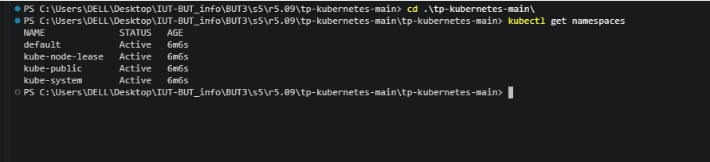

Puis je les déploie et je revérifie (je regarde aussi un namespace avec `kubectl describe namespace front`) :

```powershell
kubectl apply -f TP/front/namespace.yml
kubectl apply -f TP/middle/namespace.yml
kubectl apply -f TP/database/namespace.yml
kubectl describe namespace front
kubectl get namespaces
```

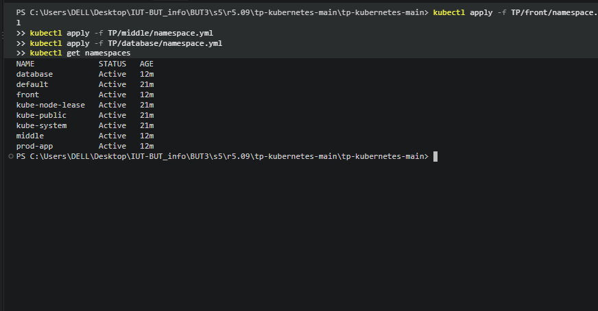

On voit bien `front`, `middle` et `database`. Il y a aussi `prod-app`, que j'avais déjà créé pour la partie 5.

### NGINX (page par défaut)

`TP/front/nginx-deployment-partie1.yml` : Deployment `nginx`, 2 replicas, label `app: reverse-proxy`, image `nginx:1.27.1-alpine`.
`TP/front/nginx-service.yml` : Service `nginx` en TCP, port 8383 vers le port 80 des pods `app: reverse-proxy`.

```powershell
kubectl apply -f TP/front/nginx-deployment-partie1.yml
kubectl apply -f TP/front/nginx-service.yml
kubectl get pods -n front
kubectl port-forward -n front svc/nginx 8080:8383
```

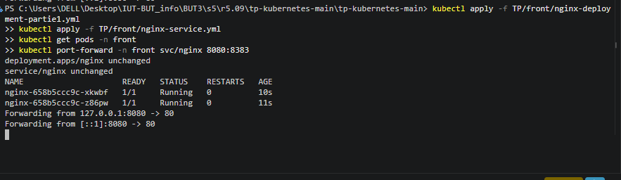

Les deux pods sont `Running` en `1/1`. (Les mentions « unchanged » viennent du fait que j'avais déjà appliqué les fichiers une première fois avant de faire la capture.)

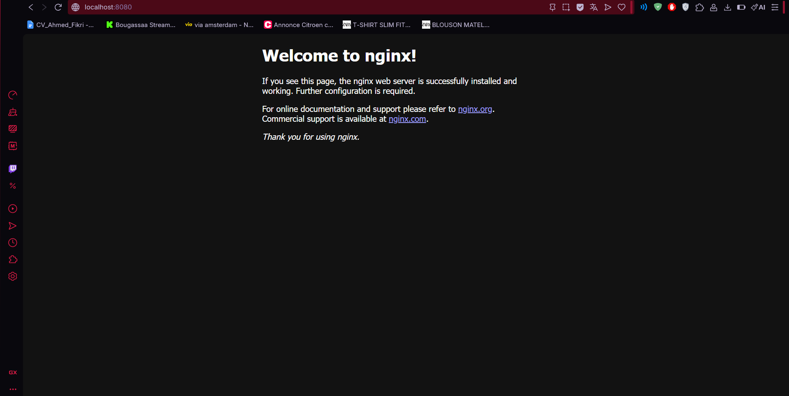

La page « Welcome to nginx! » s'affiche sur `http://localhost:8080`.

**Q4 : les 2 commandes pour vérifier les events et le démarrage ?**
`kubectl get events -n front` pour les événements du namespace, et `kubectl get pods -n front` pour voir que les pods sont `Running` et `READY 1/1` (on peut aussi faire `kubectl describe pods -n front` pour le détail).

**Q7 : les pointillés violets ?**
Ils entourent les deux pods qui ont le label `app: reverse-proxy`. C'est le Deployment `nginx` : c'est lui (via son ReplicaSet) qui s'assure qu'il y a toujours 2 pods et qui les recrée si un tombe. C'est le développeur ou le DevOps qui s'en occupe.

**Q8 : les pointillés rouges ?**
Ils entourent tout ce qu'il y a dans le namespace `front` (le Service et les pods). C'est le namespace, géré par l'administrateur du cluster. Il sert à isoler les ressources, mais à lui seul il ne bloque pas le réseau entre namespaces.

---

## Partie 2 : MySQL, WordPress et reverse proxy

### MySQL (namespace `database`)

Fichiers dans `TP/database/` :
- `mysql-secret.yml` : Secret avec `MYSQL_PASSWORD` et `MYSQL_ROOT_PASSWORD` (valeurs en base64) ;
- `mysql-configmap.yml` : ConfigMap avec `MYSQL_USER` et `MYSQL_DATABASE=wordpress` ;
- `mysql-statefulset.yml` : StatefulSet `mysql:9.0`, 1 replica, label `app: mysql`, variables prises dans la ConfigMap et le Secret, stockage persistant avec un `volumeClaimTemplates` de 1 Gio ;
- `mysql-service.yml` : Service sur le port 3306.

```powershell
kubectl apply -f TP/database/mysql-secret.yml
kubectl apply -f TP/database/mysql-configmap.yml
kubectl apply -f TP/database/mysql-service.yml
kubectl apply -f TP/database/mysql-statefulset.yml
kubectl get pods,pvc,svc -n database
kubectl exec -n database statefulset/mysql -- sh -c "env | grep -E '^MYSQL_(DATABASE|USER|PASSWORD|ROOT_PASSWORD)='"
```

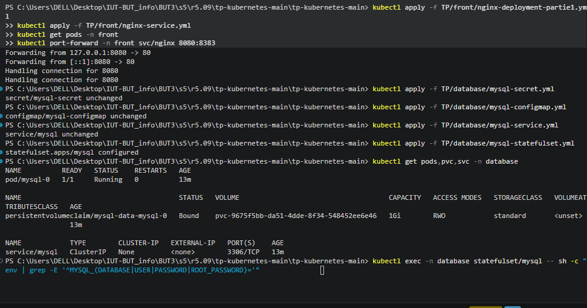

Le pod `mysql-0` est `Running 1/1`, le PVC `mysql-data-mysql-0` est `Bound` (1Gi) et le Service `mysql` existe sur le port 3306. Le Service est de type headless (`clusterIP: None`), ce qui va bien avec un StatefulSet.

### WordPress (namespace `middle`)

Fichiers dans `TP/middle/` : `wordpress-pv.yml` (PV 100Mi, ReadWriteMany, `manual`, `/tmp/kubernetes/wordpress`), `wordpress-pvc.yml`, `wordpress-deployment.yml` (image `wordpress:latest`, label `app: blog`, PVC monté dans `/var/www/html`, `WP_HOME` et `WP_SITEURL` sur `http://localhost:8080`), `wordpress-service.yml` (port 80). Le Secret et la ConfigMap MySQL sont recopiés dans `middle` (`mysql-secret.yml`, `mysql-configmap.yml`).

Pour les variables, `WORDPRESS_DB_USER` et `WORDPRESS_DB_NAME` viennent de la ConfigMap, `WORDPRESS_DB_PASSWORD` vient du Secret, et `WORDPRESS_DB_HOST` vaut `mysql.database.svc.cluster.local:3306`.

```powershell
kubectl apply -f TP/middle/mysql-secret.yml
kubectl apply -f TP/middle/mysql-configmap.yml
kubectl apply -f TP/middle/wordpress-pv.yml
kubectl apply -f TP/middle/wordpress-pvc.yml
kubectl apply -f TP/middle/wordpress-deployment.yml
kubectl apply -f TP/middle/wordpress-service.yml
kubectl get pods,pvc,svc -n middle
kubectl exec -n middle deployment/wordpress -- sh -c "env | grep '^WORDPRESS_DB_'"
```


Les 4 variables sont bien présentes avec les bonnes valeurs.

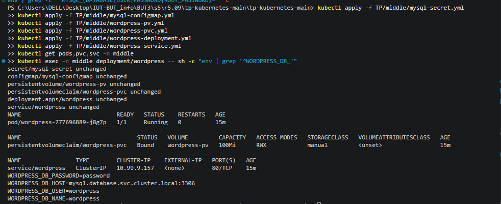

(La même capture montre aussi `kubectl get pods,pvc,svc -n middle` : le pod WordPress est `Running 1/1`, le PVC `wordpress-pvc` est `Bound` avec le PV `wordpress-pv` en 100Mi RWX/`manual`, et le Service tourne sur le port 80.)

### NGINX en reverse proxy

`TP/front/nginx-configmap.yml` contient le `default.conf` avec `proxy_pass http://wordpress.middle.svc.cluster.local:80`. Le Deployment `TP/front/nginx-deployment.yml` (même nom `nginx`) monte cette ConfigMap dans `/etc/nginx/conf.d/default.conf`.

```powershell
kubectl apply -f TP/front/nginx-configmap.yml
kubectl apply -f TP/front/nginx-deployment.yml
kubectl rollout status deployment/nginx -n front
kubectl port-forward -n front svc/nginx 8080:8383
```

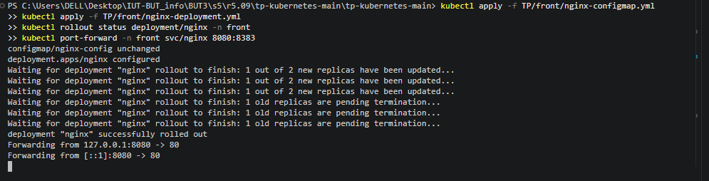

Le Deployment est mis à jour (`successfully rolled out`), puis le port-forward est relancé (l'ancien tunnel pointait vers un pod remplacé).

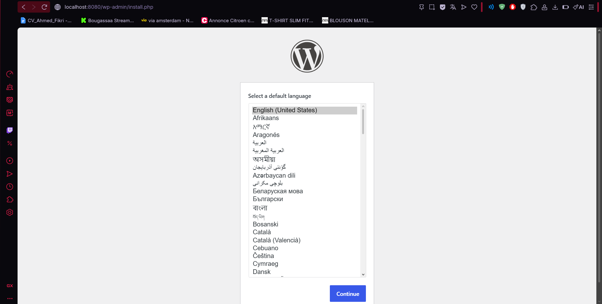

On arrive sur `http://localhost:8080/wp-admin/install.php`, la page d'installation de WordPress : nginx redirige bien vers le pod WordPress et WordPress arrive à joindre MySQL.

### Vérifications

**Les ressources sont-elles dans le bon namespace ? Quelle commande ?**
`kubectl get pods,svc,configmap,secret -n <namespace>` pour un namespace précis, ou `kubectl get all -A` pour tout voir avec la colonne NAMESPACE. Le PV n'a pas de namespace (il est global au cluster), donc je le regarde avec `kubectl get pv`.

**Pourquoi la ConfigMap et le Secret MySQL sont dans `middle` ET `database` ?**
Un pod ne peut utiliser un Secret ou une ConfigMap que s'ils sont dans son propre namespace. MySQL (dans `database`) en a besoin pour créer l'utilisateur et la base, et WordPress (dans `middle`) en a besoin pour se connecter avec les mêmes valeurs. Il faut donc une copie dans chaque namespace. L'inconvénient, c'est qu'il faut penser à modifier les deux si on change une valeur.

**Les pods sont-ils bien démarrés ? Quelle commande ?**
`kubectl get pods -n <namespace>` : je vérifie `STATUS = Running` et `READY 1/1`. Si ce n'est pas le cas, `kubectl describe pod`.

**Un pod est en erreur : comment voir les events et les logs ?**
Events : `kubectl get events -n <namespace> --sort-by=.metadata.creationTimestamp` et `kubectl describe pod <pod> -n <namespace>`. Logs : `kubectl logs <pod> -n <namespace>`, avec `--previous` si le conteneur a redémarré.

---

## Partie 3 : CronJob et HPA

### CronJob

`TP/cronjob.yml` : CronJob `date`, schedule `*/5 * * * *`, image `busybox:1.36`, commande `date`.

```powershell
kubectl apply -f TP/cronjob.yml
kubectl get cronjobs,jobs,pods
```

### HPA

- `TP/application.yml` : Deployment `mon-application` (nginx, `containerPort: 80`) avec requests CPU 50m / mémoire 64Mi et limits CPU 200m / mémoire 128Mi. L'image nginx ne donne pas de minimum officiel, j'ai pris des valeurs raisonnables pour un petit serveur statique.
- `TP/hpa-application.yml` : HPA `mon-application`, entre 1 et 3 pods, cible 30 % de CPU par rapport aux requests (donc 15m par pod, vu que la request est 50m).

```powershell
minikube addons enable metrics-server
kubectl apply -f TP/application.yml
kubectl expose deployment mon-application --port=80 --type=LoadBalancer
kubectl apply -f TP/hpa-application.yml
kubectl get cronjobs,jobs,pods
kubectl get hpa
```

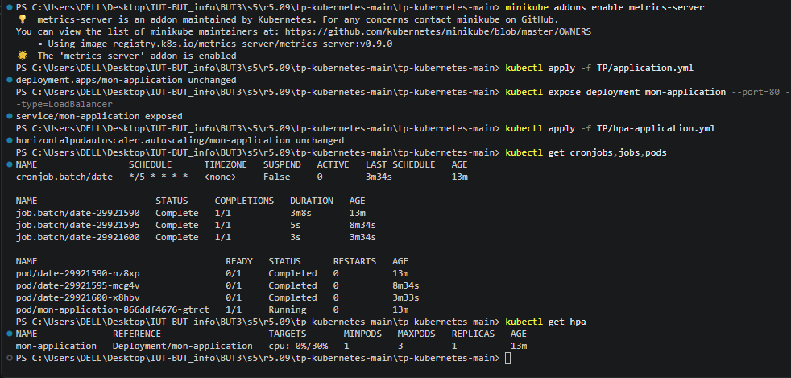

Le CronJob a déjà lancé 3 jobs, tous `Complete`. Le HPA est actif : `cpu: 0%/30%`, min 1, max 3, 1 replica.

**Q4 : résultat souhaité ?**
Quand le CPU moyen des pods dépasse 30 % de leur request, l'HPA ajoute des pods (jusqu'à 3) pour ramener la moyenne sous la cible. Quand la charge retombe, il redescend vers 1 pod, mais pas tout de suite : il attend quelques minutes pour éviter de monter et descendre en boucle. Le HPA a besoin de `requests` sur le conteneur et de metrics-server pour lire la consommation.

**Q7 : colonnes de `kubectl get hpa` ?**
`NAME` (nom du HPA), `REFERENCE` (le Deployment piloté), `TARGETS` (utilisation actuelle / cible, ici `0%/30%`), `MINPODS` et `MAXPODS` (bornes), `REPLICAS` (nombre de pods en ce moment), `AGE`. Si `TARGETS` affiche `<unknown>`, c'est que metrics-server n'a pas encore de mesure.

### Test de charge

```powershell
kubectl run -it --rm simulation-utilisateur --image=busybox:1.36 --restart=Never -- /bin/sh
# dans le shell :
while true; do wget -q -O- http://mon-application.default.svc.cluster.local; done
```

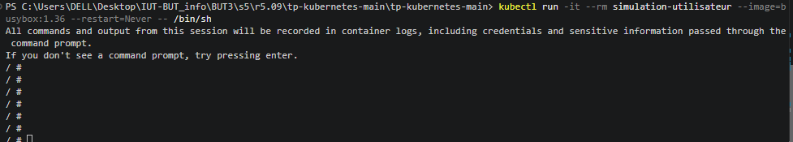

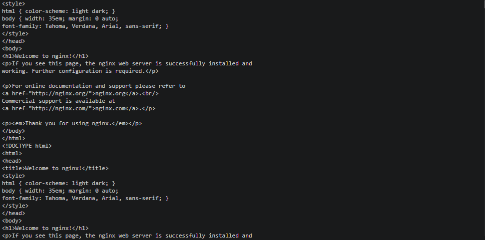

Le pod `simulation-utilisateur` démarre, et la boucle `wget` tourne : on voit en continu la page d'accueil de nginx défiler.

**Q9 : le HPA fonctionne-t-il comme souhaité ?**
Il est bien configuré et actif : `cpu: 0%/30%`, minimum 1 pod, maximum 3. Une page statique de nginx consomme très peu de CPU, donc pour franchir le seuil de 15m par pod il faut une charge forte (plusieurs pods de charge en parallèle). Si le seuil n'est pas atteint, le réglage à ajuster est `averageUtilization` (le baisser, par exemple à 20) ou la request CPU du Deployment.

---

## Partie 4 : QCM

| Question | Réponse | Pourquoi |
|---|---|---|
| 1 | B | Un Pod est un groupe d'un ou plusieurs conteneurs qui partagent réseau et volumes. |
| 2 | B | `kubectl create namespace <nom>` (la forme `ns` marche aussi, c'est un alias). |
| 3 | A | Le kubelet de chaque nœud communique avec l'API Server. |
| 4 | B | Une ConfigMap stocke de la configuration non sensible. |
| 5 | B | Un CronJob lance des Jobs selon un planning. |
| 6 | B | Un Deployment gère les ReplicaSets et donc les mises à jour des pods. |
| 7 | B | kube-proxy met en place le routage des Services vers les pods. |
| 8 | A | `kubectl logs <pod-name>`. |
| 9 | A | Un pod géré par un Deployment/ReplicaSet est recréé. |
| 10 | C | Un Secret sert pour les données sensibles. |
| 11 | B | Un namespace découpe le cluster en environnements virtuels. |
| 12 | C | PersistentVolumeClaim. |
| 13 | C | L'API Server expose l'API REST et sert de point d'entrée à toutes les opérations. |
| 14 | B | RBAC, Network Policies et sécurité des pods (les PSP sont dépréciées, remplacées par Pod Security Admission). |
| 15 | A | Des requests trop basses entraînent trop de pods sur un nœud, des limits trop basses du throttling. |
| Bonus | C | Les Secrets sont en base64 dans etcd mais pas chiffrés par défaut. |

---

## Partie 5 : application « production-ready »

Manifests dans `TP/partie5/` : `namespace.yml`, `app-deployment-initial.yml` (version de départ, image 1.10, 3 replicas), `app-deployment.yml` (version finale avec resources, probes, RollingUpdate, preStop et image 1.10.1) et `app-service.yml` (ClusterIP, port 8080).

### 1. Déploiement initial

```powershell
kubectl apply -f TP/partie5/namespace.yml
kubectl apply -f TP/partie5/app-deployment-initial.yml
kubectl apply -f TP/partie5/app-service.yml
kubectl get pods,svc -n prod-app
kubectl port-forward -n prod-app svc/hello-kubernetes 8080:8080
```

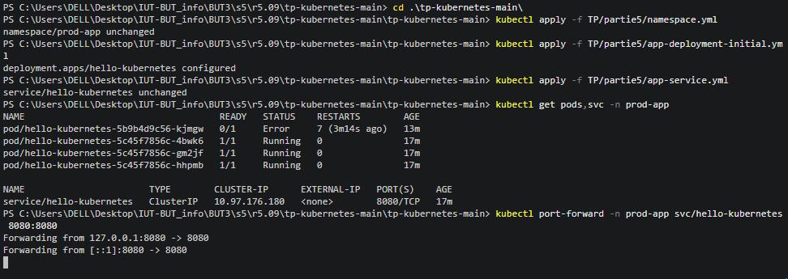

Les 3 pods de la version initiale (`5c45f7856c`) sont `Running 1/1` et le port-forward est lancé. On voit aussi un quatrième pod en `Error` avec plusieurs redémarrages : il vient d'un essai précédent avec la version finale (voir plus bas).

**Que remarque-t-on sur « Pod Name » ?**
`kubectl port-forward svc/...` ne fait pas d'équilibrage de charge. kubectl choisit un seul pod derrière le Service au moment d'ouvrir le tunnel et envoie tout dessus, donc le nom du pod reste en général le même à chaque rafraîchissement, même avec 3 replicas. Le Service, lui, répartit bien le trafic entre les pods (via kube-proxy), mais le port-forward court-circuite ça. Pour le vérifier depuis l'intérieur du cluster :

```powershell
kubectl run test --rm -it --image=busybox:1.36 --restart=Never -n prod-app -- /bin/sh -c "for i in 1 2 3 4 5 6; do wget -qO- http://hello-kubernetes:8080 | grep -i pod; done"
```

### 2. Requests et limits (QoS)

Requests : CPU 100m, mémoire 64Mi. Limits : CPU 200m, mémoire 128Mi.

**Quelle classe de QoS, et pourquoi viser au moins Burstable ?**
Le pod est en **Burstable** : il a des requests et des limits, mais elles ne sont pas égales (`Guaranteed` demanderait requests = limits, `BestEffort` aucune valeur). En production il faut viser au moins Burstable parce qu'un pod `BestEffort` n'a aucune ressource réservée et il est le premier évincé quand le nœud manque de mémoire. Avec des requests, le scheduler sait où le placer, et avec des limits il ne peut pas manger toutes les ressources du nœud.

### 3. Probes

Dans `app-deployment.yml` : `livenessProbe` HTTP GET `/healthz` sur le port 8080, `readinessProbe` HTTP GET `/ready` avec `initialDelaySeconds: 10`.

**Que se passe-t-il si l'appli se bloque (deadlock) sans crasher ? Comment la liveness aide ?**
Le processus tourne toujours, donc Kubernetes ne voit rien et le pod reste dans le Service sans répondre. Avec la `livenessProbe`, `/healthz` ne répond plus, et après plusieurs échecs le kubelet redémarre le conteneur, ce qui règle le blocage tout seul.

**Différence entre un échec de liveness et de readiness ?**
Échec de liveness : le conteneur est **redémarré** par le kubelet. Échec de readiness : le conteneur n'est **pas redémarré**, mais le pod est retiré des endpoints du Service et ne reçoit plus de trafic tant qu'il n'est pas prêt. C'est donc le **Service** (via les EndpointSlices / kube-proxy) qui arrête d'envoyer du trafic.

### 4. Ce qui s'est passé quand j'ai appliqué la version finale

```powershell
kubectl get pods -n prod-app -w
kubectl apply -f TP/partie5/app-deployment.yml
```

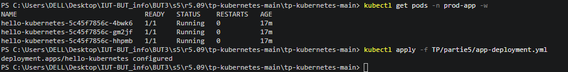

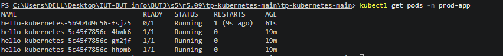

**Point de blocage.** Avec la version finale, le nouveau pod (`hello-kubernetes-5b9b4d9c56-...`) ne passe pas à `1/1` : il reste en `0/1` et redémarre (`RESTARTS` qui augmente, statut `Error` sur la capture 10a). Les 3 anciens pods continuent de tourner, ce qui est le comportement attendu avec `maxUnavailable: 0` : le RollingUpdate ne supprime pas les anciens pods tant que le nouveau n'est pas prêt, donc il n'y a pas de coupure.

**Rôle de la readiness dans un RollingUpdate sans interruption ?**
Kubernetes ne retire un ancien pod que quand le nouveau est `Ready`. Sans readiness probe, un pod est « prêt » dès que son conteneur démarre, même si l'appli n'est pas encore capable de répondre, et le trafic arriverait trop tôt (erreurs 503) alors que les anciens pods sont déjà supprimés. Avec `maxSurge: 1` et `maxUnavailable: 0`, on garde toujours au moins 3 pods prêts. Ce qu'on a vu sur la capture 12b (le nouveau pod à `0/1` pendant que les anciens restent `1/1`) illustre exactement ça.

### 5. Arrêt gracieux (preStop)

Le conteneur a un hook `preStop` : `sleep 10`.

**À quoi sert le `preStop` ? Que ferait une vraie appli pendant ce temps ?**
Il s'exécute avant l'envoi du SIGTERM. Pendant ce délai le pod est déjà retiré des Services, mais il peut finir son travail. Dans une vraie application : terminer les requêtes en cours, arrêter d'accepter de nouvelles connexions, vider les files de messages ou jobs, fermer proprement les connexions à la base de données, écrire ses logs. Le délai laisse aussi le temps à la suppression des endpoints de se propager pour qu'aucune nouvelle requête n'arrive pendant l'arrêt.

### 6. Débogage avec un conteneur éphémère

Commandes :

```powershell
kubectl exec -n prod-app <pod> -- curl localhost:8080          # curl n'est pas dans l'image de l'application (comme l'indique le sujet)
kubectl debug -it <pod> -n prod-app --image=busybox:1.36 --target=hello-kubernetes
# dans le shell de debug :
wget -O - http://localhost:8080
```

**Pourquoi c'est mieux que d'avoir tous les outils dans l'image ?**
Moins d'outils dans l'image de prod, c'est une surface d'attaque plus petite (un attaquant n'a pas de `curl` ou de shell complet sous la main), une image plus légère et avec moins de failles à corriger. L'image reste la même partout, on ne la reconstruit pas pour déboguer. Et les outils n'existent que le temps du diagnostic, dans un conteneur éphémère qui disparaît avec le pod, sans toucher au conteneur de l'application. L'usage reste contrôlé par les droits RBAC.
